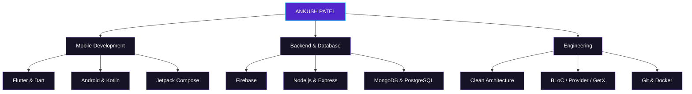
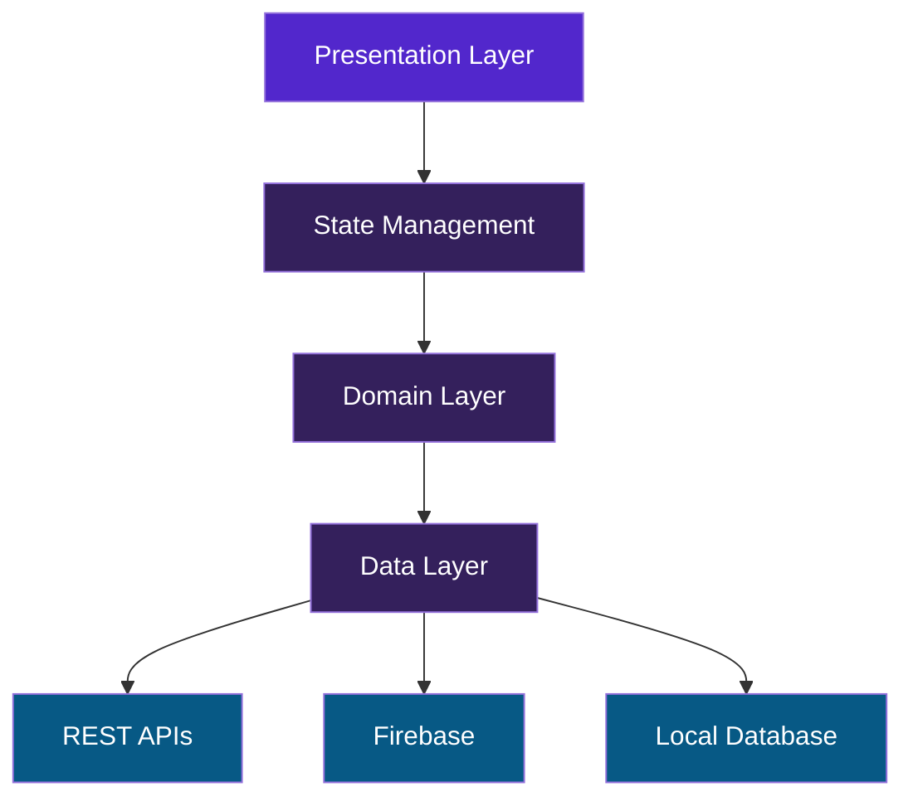

# Ankush Patel

### Software Developer | Flutter & Android Engineer

> Building scalable mobile applications with clean architecture, thoughtful UI and reliable engineering.

---

## About Me

I'm **Ankush Patel**, a Software Developer focused on mobile application development.

- Flutter and native Android development.
- Building scalable and maintainable applications.
- Firebase and REST API integration.
- State management and application architecture.
- Exploring backend development and modern technologies.

**Philosophy:** Build. Learn. Improve. Repeat.

---

## Technology Stack

| Category | Technologies |
|---|---|
| Mobile | Flutter, Dart, Kotlin, Java |
| Android | Jetpack Compose, XML, Android SDK |
| State Management | BLoC, Provider, GetX |
| Architecture | MVVM, Clean Architecture, SOLID |
| Backend | Node.js, Express.js, REST APIs |
| Database | Firebase, Firestore, MongoDB, PostgreSQL, Redis |
| API Integration | Dio, Retrofit, Gson |
| Tools | Android Studio, VS Code, Git, GitHub, Postman, Docker |
| Design | Figma, Material Design |

---

## Development Ecosystem

---

## Application Architecture

---

## Currently Exploring

- Advanced Flutter development
- Kotlin and Jetpack Compose
- Scalable backend architecture
- Application performance optimization
- System design and clean code

---

## Let's Connect

| Platform | Link |
|---|---|
| GitHub | [AnkushPatel001](https://github.com/AnkushPatel001) |
| LinkedIn | [Connect with me](https://www.linkedin.com/in/ankush-patel-4305182b2/) |
| Email | [patelankush306@gmail.com](mailto:patelankush306@gmail.com) |

---

**"Great software is built with curiosity, consistency and creativity."**

*Thanks for visiting my profile!*

